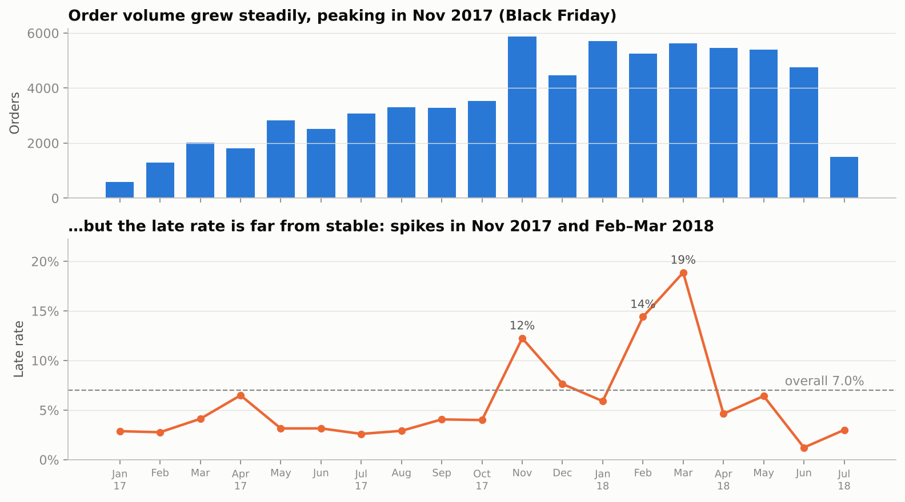
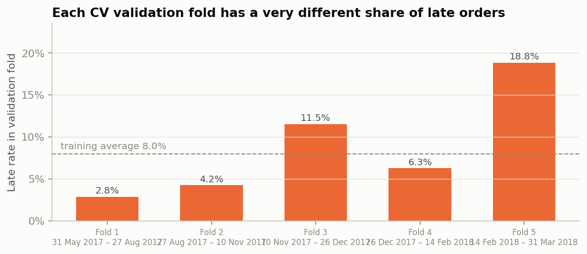
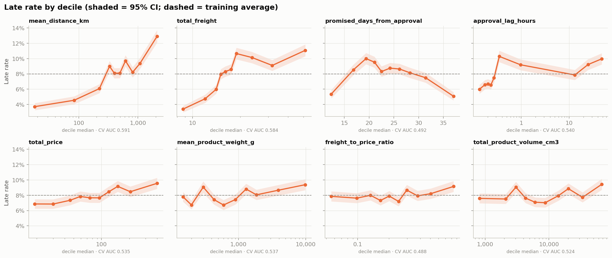
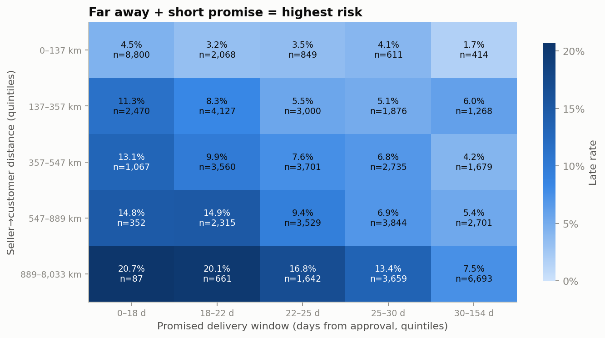
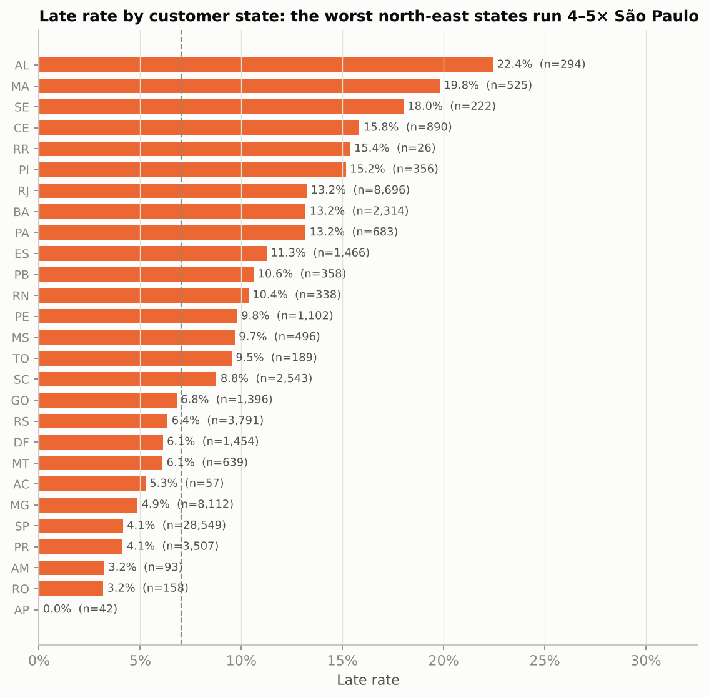
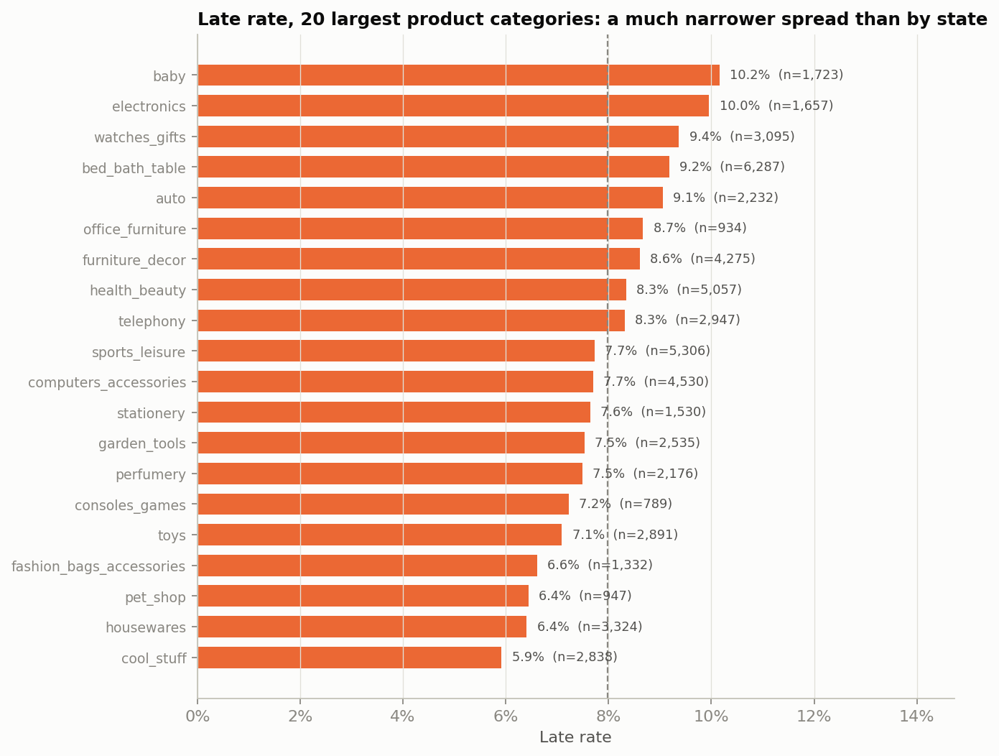
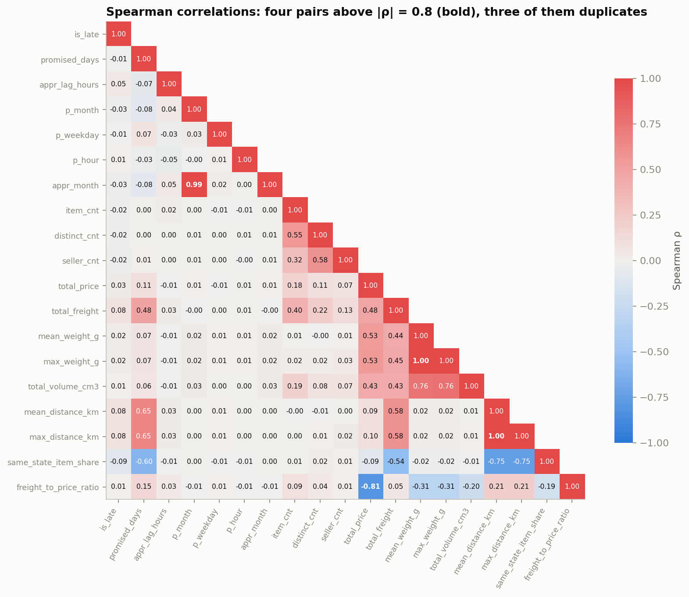
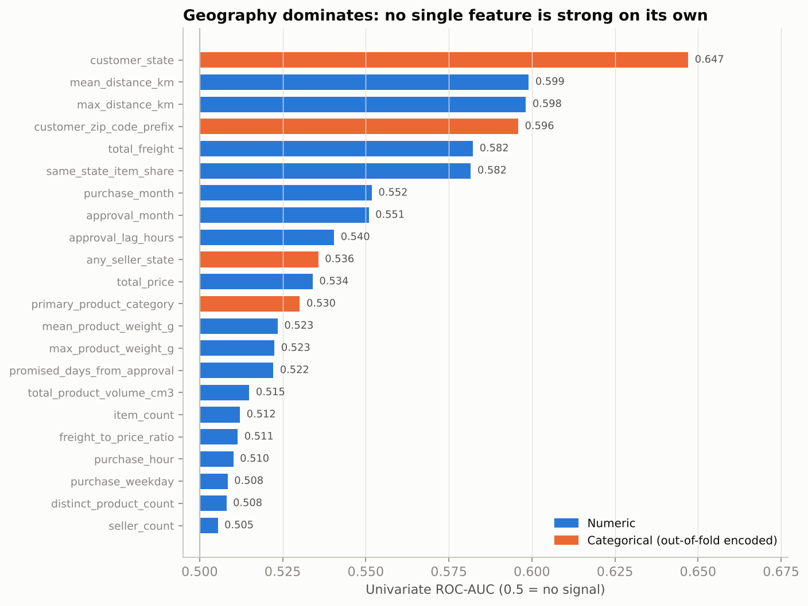

# Predicting late deliveries on Olist

INSY 674, McGill, Fall 2026. Final group project, Group 9.

| Name | Student ID | Role |
|---|---|---|
| Jay Malhotra | 261308594 | Project lead: framing, repo and shared code, feature iteration (4.4), integration |
| Hasan Malik | 261360960 | Exploring the data (2) |
| Mia Scalabrin | 261317371 | Preparing the data (3) |
| Fidan Shiraliyeva | 261035730 | Model comparison and shortlist (4.1, 4.5) |
| Jingyu Wu | 261323701 | Interpretation and error analysis (4.2, 4.3) |
| Tasnim Hassan | 261343745 | Tuning, ensembles and final test evaluation (5) |
| Peace Isaac | | Presentation and slides |

<!-- Jay: fill in the remaining student IDs before submission. -->

**Research question:** Using only information available when an order is approved, how accurately can we predict which orders will arrive after the promised delivery date, and which factors contribute most to that risk?

**Short answer:** checking the riskiest 10% of orders each day would have caught 36% of late orders in the test period, against 10% for random checks. Late deliveries happen when the promise is too short for the distance, and where the parcel is going matters more than what is in it (section 6).

The sections follow the project checklist from the rubric (Géron, Appendix B). Each section has its own notebook, run in this order:

| Section | Notebook |
|---|---|
| 1. Frame the Problem and Look at the Big Picture | `notebooks/01_frame_the_problem.ipynb` |
| 2. Explore the Data | `notebooks/02_explore_the_data.ipynb` |
| 3. Prepare the Data | `notebooks/03_prepare_the_data.ipynb` |
| 4.1, 4.5 Model comparison and shortlist | `notebooks/04a_compare_models.ipynb` |
| 4.2, 4.3 Interpretation and error analysis | `notebooks/04b_interpretation_and_errors.ipynb` |
| 4.4 Feature iteration and split check | `notebooks/04c_feature_iteration.ipynb` |
| 5. Fine-Tune the System | `notebooks/05_fine_tune.ipynb` |

## 1. Frame the Problem and Look at the Big Picture

### 1.1 Objective

Olist is a Brazilian marketplace that connects small sellers to large online stores. When a customer buys something, Olist gives them an estimated delivery date. Between January 2017 and July 2018, 5,986 of 85,371 delivered orders (7.0%) arrived after that date.

Late orders hurt reviews badly. They averaged 2.21 stars compared to 4.28 for orders that arrived on time, and 62.5% of them got a 1 or 2 star review (9.3% for on-time orders).

Our goal is to flag orders that are likely to be late early enough for someone to do something about it, instead of finding out from a bad review.

### 1.2 Research question

Using only information available when an order is approved, how accurately can we predict which orders will arrive after the promised delivery date, and which factors contribute most to that risk?

This has two parts. The first is how well we can rank late orders above on-time ones at approval (section 5). The second is which order, product, seller and route characteristics drive the risk (sections 4.2 and 5.4).

### 1.3 Who would use it

The main user is Olist's operations team. Every morning, the orders approved the day before get a risk score, and the riskiest 10% are flagged. For those, the team can push the seller to ship sooner, follow up with the carrier, or warn the customer and give a new date.

Seller managers could also use the scores averaged by seller to see which sellers cause the most late orders.

The model only ranks orders so people know where to look. It does not change delivery dates on its own.

### 1.4 What Olist does today

The public dataset does not document whether Olist had an internal order-level risk score. One observable safeguard is the generous promised delivery window: the median promised window is 24 days, while the median delivery actually takes 10. That works for the average order, but it treats every order the same. Even with the padding, the late rate hit 12.4% in November 2017, 14.1% in February 2018 and 19.0% in March 2018.

### 1.5 How we framed the problem

It is a supervised binary classification problem. Every past order has a known outcome (late or not), and the decision we want to support is yes or no: act on this order or leave it. We considered predicting the number of days late instead, but the team would still need to decide whether to act, so a risk ranking is more useful.

The model is trained offline and scores new orders once a day in a batch. Delivery problems play out over days, so a real-time score would not add anything. Predictions are made at `order_approved_at`, and we only use information that exists at that moment (see section 3.4).

The data is tabular, built by joining the relevant Olist order, item, product, seller, customer, geolocation, and product-category translation tables. Payments and reviews are excluded from predictive features because their availability at order approval cannot be reliably established. The classes are imbalanced: about 1 order in 14 is late overall, and 1 in 12.5 in the training period.

### 1.6 How we measure performance

Our main metric is PR-AUC (average precision). It focuses on the late orders, which are the rare class we care about.

The metric that matches how the team would actually work is recall in the top 10%: if ops can only check 10% of orders a day, what share of all late orders do they catch? We also report it at 5% and 20%, plus ROC-AUC for comparison with other work.

Accuracy is not useful here. Predicting "on time" for every order gives 95.9% accuracy on our test set and catches no late orders at all.

Every model is scored with the same 5-fold time-series cross-validation on the training period (`TimeSeriesSplit` with a 2,000-order gap, defined in `src/evaluation.py`), reported as mean and standard deviation. Notebooks 04a and 04b write out their own copy of the same splitter and metrics; their numbers match the shared code (notebook 05 re-scores the three shortlisted models with `src/evaluation.py` and gets the same PR-AUC to within 0.001). The test set is used once, at the end.

### 1.7 Baselines

| Baseline | What it is | Test PR-AUC | Test recall, top 10% |
|---|---|---:|---:|
| B0 | Random ranking (no skill) | 0.041 | 10% |
| B1 | Logistic regression on promised days and customer state | 0.109 | 33.6% |

B0's expected PR-AUC equals the test late rate (one random draw in 5.3 gave 0.042). B1 is trained the same way as the final model (section 5.3). To be worth anything, the final model has to beat B1, not just B0.

### 1.8 Data

We used the Brazilian E-Commerce Public Dataset by Olist from Kaggle (CC BY-NC-SA 4.0). The raw files are in `data/raw/` and the licence is in `DATA_LICENSE.md`.

| Step | Orders |
|---|---:|
| All orders (Sept 2016 to Oct 2018) | 99,441 |
| Status is delivered | 96,478 |
| Has approval and delivery dates | 96,456 |
| Bought from January 2017 onward | 96,189 |
| Promised by 1 August 2018 | 85,371 |

The last filter is needed because the data effectively stops at the end of August 2018. An order promised for late August that showed up late would never appear as delivered, so without this filter the most recent months would look better than they really were. All of these choices are written up in `DECISIONS.md`.

| Set | Orders bought | Orders | Late rate |
|---|---|---:|---:|
| Train | Jan 2017 to Mar 2018 | 64,038 | 8.0% |
| Test | Apr 2018 to Jul 2018 | 21,333 | 4.1% |

We split by date because the model would be used on future orders. The late rate in the test period is about half the training rate, which we come back to in section 7.

## 2. Explore the Data

Notebook: `notebooks/02_explore_the_data.ipynb` (Hasan Malik). Everything in this section uses the training period only (64,038 orders bought before 1 April 2018). The test period was not explored.

### 2.1 Attribute profile

The full profile of all 29 columns is in `reports/eda_profiling_table.csv`. For each column it gives the source table, whether it is known at approval, type, bounds, % missing, number of distinct values, skew, share of outliers, noise notes, distribution shape and usefulness. Data-quality issues are listed in `reports/eda_data_quality_issues.csv`.

Usefulness is how well a feature ranks late orders on its own: ROC-AUC across the 5 time-series folds, where 0.50 is no better than random. The 22 candidate features, from most to least useful:

| Feature | Type | Missing | Note | Usefulness (AUC) |
|---|---|---:|---|---:|
| `customer_state` | category | 0 | SP 40% of orders; NE states 4 to 5 times SP's late rate | 0.633 |
| `mean_distance_km` | numeric | 0.52% | Straight-line km between zip centroids; 3 values above 4,500 km | 0.591 |
| `max_distance_km` | numeric | 0.52% | Same as mean distance for 98% of orders | 0.590 |
| `total_freight` | numeric (BRL) | 0 | Skew 8.7; mostly a stand-in for distance | 0.584 |
| `same_state_item_share` | share, 0 to 1 | 0 | Effectively yes/no; cross-state 9.7% late vs 4.6% | 0.571 |
| `customer_zip_code_prefix` | code (13,584 values) | 0 | Too many levels; dropped (3.2) | 0.555 |
| `approval_lag_hours` | numeric | 0 | Skew 5.2; 65% approved within an hour | 0.540 |
| `mean_product_weight_g` | numeric | 0.02% | Seller-entered, heaped at round values | 0.537 |
| `max_product_weight_g` | numeric | 0.02% | Same as mean weight for single-product orders | 0.536 |
| `total_price` | numeric (BRL) | 0 | Skew 11.1; real large baskets, not errors | 0.535 |
| `total_product_volume_cm3` | numeric | 0 | 16 orders stored as 0 (missing dimensions) | 0.524 |
| `purchase_weekday` | integer (calendar) | 0 | Close to flat | 0.521 |
| `purchase_month` | integer (calendar) | 0 | Jan to Mar seen twice, other months once; dropped in 5.1 | 0.519 |
| `approval_month` | integer (calendar) | 0 | Equals purchase month for 98.2%; dropped (3.2) | 0.518 |
| `primary_product_category` | category | 1.83% | 71 levels, long tail; 'unknown' when missing | 0.513 |
| `any_seller_state` | category | 0 | SP 71% of orders | 0.513 |
| `purchase_hour` | integer (calendar) | 0 | Close to flat | 0.511 |
| `distinct_product_count` | count | 0 | 97% single-product | 0.508 |
| `seller_count` | count | 0 | 98.9% single-seller | 0.506 |
| `item_count` | count | 0 | 90% single-item | 0.502 |
| `promised_days_from_approval` | numeric | 0 | Inverted U on its own; strong with distance (2.3) | 0.492 |
| `freight_to_price_ratio` | numeric | 0 | Skew 3.7; explodes for very cheap items | 0.488 |

The other 7 columns are not model inputs: the two IDs, the three raw timestamps (used only through the derived timing features), `order_delivered_customer_date` (known only after delivery, used only to build the target) and the target itself.

- **Missing values are rare.** Product category is missing for 1.83% of orders, distance for 0.52% and weight for 0.02%. Nothing had to be dropped.
- **Skew is the main issue.** Price, freight, volume, approval lag, freight ratio and weight are all heavily right-skewed, with 6.8% to 14.6% of values outside 1.5 times the IQR. These are real orders (big baskets, heavy items, slow approvals), not errors, so they are log-transformed rather than removed.
- **Three pairs are near-duplicates:** mean and max distance, mean and max weight, purchase and approval month (Spearman correlation 0.99 to 1.00).

### 2.2 Target

`is_late` = 1 when the order reached the customer on a later calendar day than promised (D3). In the training period, 5,110 of 64,038 orders were late (8.0%), about 11.5 on-time orders for every late one. Predicting "on time" for everything would score 92.0% accuracy and catch nothing.



**Lateness comes in waves, and the biggest one ends the training period.** From January to October 2017 the late rate stays between 2.8% and 4.6% (6.6% in April 2017). Then it jumps to 12.4% in November 2017, 14.1% in February 2018 and 19.0% in March 2018. Those three months hold 33% of training orders but 62% of the late ones. The spikes look mostly system-wide: median delivery time stretched from 11.2 days in January 2018 to 14.0 in February, and even São Paulo's late rate nearly tripled (3.4% to 9.4%). March also had the shortest median promise of any month (21.0 days against 25.4 in January), which the model can see.



**The CV folds inherit these waves.** Validation late rates range from 2.8% to 18.8%, and a random model's PR-AUC equals the late rate. Raw PR-AUC is therefore much higher in the spike folds whatever the model does, so models are compared on **lift**: PR-AUC divided by the fold's late rate.

### 2.3 Key plots



**Distance is the clearest single driver.** The late rate rises from 3.7% for the nearest tenth of orders (under 41 km) to 12.9% for the farthest (over 1,469 km). Freight follows the same pattern (3.4% to 11.1%) because it is mostly priced on distance. Promised days on its own is an inverted U: 5.4% late for the shortest promises, 10.0% at about 18 to 20 days, 5.1% for the longest. That shape is why it scores below 0.50 on its own.



**Late deliveries happen when the promise is too short for the distance.** Orders travelling over 889 km with a promise of 22 days or less were late 20.1% to 20.7% of the time. Orders under 137 km with a promise of 30 days or more were late 1.7% of the time. Neither variable shows this on its own: Olist already gives far customers longer promises, just not long enough on the longest routes.



**Where the order goes matters most.** Customer state is the strongest single feature (AUC 0.633). North-eastern states are the worst: Alagoas 25.0%, Maranhão 19.6%, Sergipe 17.3% and Ceará 16.1%, against 4.8% for São Paulo, which has 40% of orders. Rio de Janeiro is late 15.6% of the time, 2.9 times Minas Gerais (5.3%), even though Rio's customers are closer to their sellers and get the same promise. Regional delivery conditions matter beyond distance.



**What is shipped barely matters.** The 20 largest categories range from 5.9% to 10.2% late, and category scores just 0.513. Seller state, weekday and hour are also close to flat (figure `08_seller_state_weekday_hour.png`).

### 2.4 Correlations



- **Geography forms one cluster.** Distance correlates with the promise (0.65), with freight (0.58) and with same-state share (−0.75), because Olist sets both freight and the promise from distance.
- **No numeric feature has a strong straight-line link with lateness.** The largest is 0.089 (same-state share). The signal is in curves and combinations, like distance with the promise.
- **One of each duplicate pair can go.** `approval_month` was dropped in section 3. The two `max_` columns were kept, and the final model's L1 penalty set `max_distance_km` and `mean_product_weight_g` to exactly zero, so the overlap is handled.



Geography takes the top five spots in the usefulness ranking. No feature reaches 0.64 on its own, so predictive power has to come from combining them.

### 2.5 Promising transformations

| Transformation | Why | What happened |
|---|---|---|
| `log1p` on price, freight, weight, volume, distance, approval lag and freight ratio | Heavy right skew | Applied in 3.2 |
| Missing-distance flag | Orders with missing distance are late 10.0% of the time vs 8.0% | Added in 3.4 |
| Group rare categories and states | Small groups give unreliable rates | Applied in 3.3 |
| Drop near-duplicate and too-detailed columns | `approval_month`, zip code | Dropped in 3.2 |
| Promised days per 100 km | Captures the distance-promise interaction; AUC 0.614 on its own vs 0.492 for raw promised days | Tested in 4.4: no gain, the model already combines the two |
| Cross-state flag | AUC 0.570 | Carries the same information as `same_state_item_share`, so not added |

### 2.6 Extra data that would help

| Extra data | Why it should help | Usable at approval? |
|---|---|---|
| Seller's past late rate | Seller reliability is invisible in one order | Yes, if built only from earlier deliveries. Tested in 4.4: no gain |
| `shipping_limit_date` (seller's deadline to hand over to the carrier) | A tight dispatch deadline relative to the promise | Yes, in the raw item table |
| Holiday and disruption calendar (Black Friday, Carnival, strikes) | The spikes look system-wide | Yes, for scheduled events |
| Road distance or carrier route | Straight-line km understates remote routes | Yes |
| Carrier and service level | Carriers differ in reliability | Not in the public data |
| Repeat-customer flag | `customer_id` is unique per order | Yes |

### 2.7 What we learned

1. 8.0% of training orders are late, so accuracy is useless. We use PR-AUC and recall in the top 10%.
2. Late deliveries happen when the promise is too short for the distance (about 20% late on long routes with short promises, about 2% on short routes with long ones).
3. Where the order goes matters most. Customer state is the strongest single feature, and regional conditions matter beyond distance (Rio vs Minas Gerais).
4. What is ordered, who sells it and when it is bought barely matter.
5. Lateness comes in system-wide waves (November 2017, February to March 2018), so CV folds have very different late rates and models must be compared on lift.
6. No single feature is strong. We expected tree models to win because the signal is in curves and combinations. They did not: logistic regression won (sections 4.1 and 5).

## 3. Prepare the Data

Notebook: `notebooks/03_prepare_the_data.ipynb` (Mia Scalabrin). The merged table is built from the raw files by `scripts/build_olist_model_table.py`.

### 3.1 Cleaning

All fills are fitted inside the pipeline (3.4), on training data only.

| Issue (training period) | Orders | What we did | Why |
|---|---:|---|---|
| Missing product category | 1,169 (1.83%) | Filled with "unknown" | Keeps the orders; "unknown" becomes its own category |
| Missing distance | 330 (0.52%) | Median, plus a "was missing" flag | Missing distance means the zip code was not in the geolocation table, and these orders are late more often (10.0% vs 8.0%) |
| Missing product weight | 16 (0.02%) | Median | Too few to matter |
| Extreme values in skewed columns | 6.8% to 14.6% per column | Kept, log-transformed | They are real orders, not errors |
| Duplicate orders | 0 | None needed | Every `order_id` appears once |
| Distances over 4,500 km, and volumes stored as 0 | 3 and 16 | Left as is | Geocoding errors and missing dimensions on 19 orders (0.03%); too few to change results. Listed in section 7 |

### 3.2 Feature engineering and table integration

`scripts/build_olist_model_table.py` joins the order, customer, item, product, seller, geolocation and category-translation tables into one row per order (`data/processed/olist_merged_modeling.csv`, 96,456 delivered orders, 29 columns). Items and sellers are aggregated per order: counts, totals, means and maxima, distance between seller and customer zip centroids, and the share of items shipped within the customer's state. Reviews are left out because they only exist after approval. Payments are left out because we could not confirm they are known at approval. The delivery date is used only to build the target. After the population filters in section 1.8, 85,371 orders remain (`data/processed/olist_final.csv`).

| Group | Features | Why it should predict lateness |
|---|---|---|
| Timing | promised days, approval lag, purchase month, weekday, hour | Short promises and slow approvals leave less slack |
| Location | customer state, seller state | Some regions are harder to deliver to |
| Distance | mean and max distance, same-state share | Longer routes take longer |
| Order size and cost | item count, product count, seller count, price, freight, freight-to-price ratio | Bigger or multi-seller orders are harder to ship |
| Product | weight, volume, category | Heavy or bulky items are slower to handle |

Two features were dropped: `customer_zip_code_prefix` (13,584 values, and state plus distance already describe location) and `approval_month` (identical to purchase month for 98.2% of orders). That leaves 20 features. The 13 columns with skew above 1 get a `log1p` transform. Continuous features are not binned because the models can use the raw values. `purchase_month` was later removed during tuning (5.1).

### 3.3 Scaling and encoding

- **Scaling:** every numeric column is standardised (mean 0, standard deviation 1), so price, grams and kilometres are on the same scale.
- **Encoding:** customer state (27 values), seller state (22) and product category (71) are one-hot encoded. Categories with fewer than 100 training orders are grouped into one "infrequent" column, and so are categories first seen in validation or test data. The final model uses a threshold of 20, chosen during tuning (5.1).
- The result is 103 inputs per order.

### 3.4 Pipeline and leakage checks

Every step (imputation, missing flag, log transform, scaling, one-hot encoding) sits in one scikit-learn `ColumnTransformer`, chained with the model in a `Pipeline`. In cross-validation it is refitted on each fold's training part. For the final test, it is fitted on training data only and then applied to the test set.

| Columns | Known at approval? | Reason |
|---|---|---|
| Timing, location, distance, order size and cost, product | Yes | Come from the purchase, approval and promised dates and from the order contents, all fixed at checkout |
| `customer_zip_code_prefix`, `approval_month` | Yes, but dropped | Too detailed, and a duplicate of purchase month |
| `order_status`, carrier and delivery dates, review columns | No | Only known during or after delivery; listed in `config.BANNED_FEATURE_COLUMNS` |
| `is_late` | No | The target |

On top of the column checks, leakage is controlled by the time split (D6), a 2,000-order gap between training and validation in every fold and before the test set (D7), and the rule that any history feature may only use orders delivered before the current purchase (D10). The tests in `tests/` check the target, population, split and metric code.

## 4. Measure and Compare Performance

All models use the section 3 pipeline and the same 5 time-series folds as `src/evaluation.py`, on the training period only.

### 4.1 Model comparison

Notebook: `notebooks/04a_compare_models.ipynb` (Fidan Shiraliyeva). Seven models from five families plus the two baselines, default settings, sorted by lift.

| Model | Lift | PR-AUC | Recall top 10% | ROC-AUC | Fit time per fold |
|---|---|---|---|---|---:|
| Logistic regression | **1.81 ± 0.21** | 0.158 ± 0.122 | 21.5% ± 2.7 | 0.667 ± 0.032 | 0.8 s |
| Logistic regression, balanced | 1.81 ± 0.19 | 0.157 ± 0.118 | 21.5% ± 2.4 | 0.664 ± 0.031 | 1.9 s |
| B1: promised days + customer state | 1.76 ± 0.35 | 0.150 ± 0.107 | 20.1% ± 5.1 | 0.646 ± 0.035 | 0.2 s |
| Linear SVM | 1.76 ± 0.26 | 0.155 ± 0.121 | 20.8% ± 3.1 | 0.663 ± 0.033 | 0.7 s |
| Random forest | 1.61 ± 0.16 | 0.141 ± 0.107 | 18.6% ± 2.2 | 0.638 ± 0.029 | 18.1 s |
| Gradient boosting (HistGB) | 1.54 ± 0.24 | 0.139 ± 0.109 | 17.1% ± 3.6 | 0.620 ± 0.049 | 7.1 s |
| Gaussian naive Bayes | 1.37 ± 0.11 | 0.119 ± 0.089 | 14.8% ± 1.0 | 0.603 ± 0.025 | 0.3 s |
| Decision tree | 1.25 ± 0.16 | 0.110 ± 0.084 | 15.4% ± 2.1 | 0.569 ± 0.034 | 0.5 s |
| B0: random | 1.00 ± 0.03 | 0.088 ± 0.067 | 9.9% ± 0.9 | 0.501 ± 0.007 | 0 s |

The PR-AUC spread is large because fold late rates range from 2.8% to 18.8% (2.2). Lift removes that effect.

- **Linear models lead,** and only by a little over B1. Promised days and customer state already carry most of the signal.
- **Tree models start below B1** on default settings. They overfit: their lift on training folds was 6 to 12 times their validation lift (5.1).
- **Naive Bayes and a single decision tree are the weakest.**
- **Gradient boosting** uses scikit-learn's `HistGradientBoostingClassifier`, its histogram-based version of the boosted trees covered in class, modelled on LightGBM. It runs inside the same pipeline and folds as every other model.

### 4.2 Most important variables

Notebook: `notebooks/04b_interpretation_and_errors.ipynb` (Jingyu Wu). Logistic regression, trained on the 51,365 orders before the last validation fold and checked on that fold (14 February to 31 March 2018, 10,673 orders, 18.8% late, PR-AUC 0.356). This fold is the March spike, so it is a hard period; the test-set importance in 5.4 gives the same top drivers on calmer months.

| Feature | Drop in PR-AUC when shuffled |
|---|---:|
| Customer state | 0.111 |
| Promised days | 0.050 |
| Same-state share | 0.035 |
| Mean distance | 0.021 |
| Seller state | 0.017 |
| Every other feature | under 0.01 |

The largest coefficients need more care. Alagoas (+0.90) and Rio de Janeiro (+0.58) raise the risk, Paraná (−0.73) and Minas Gerais (−0.68) lower it, and a longer promise lowers it (−0.71 per standard deviation). But three of the four largest coefficients belong to product categories: audio (+0.81), home appliances (−0.80) and luggage accessories (−0.75). Each of these is under 1.2% of training orders (231 to 767 orders), so those coefficients rest on small groups, and shuffling the whole category column lowers PR-AUC by only 0.009. Permutation importance is the better guide to what the model relies on, and it matches the EDA ranking in 2.1: geography and the promise, not the product.

The random forest and HistGB were checked the same way (04b, section 4.3.5). All three models rely on the same four variables: customer state, promised days, same-state share and distance. HistGB also uses freight, which is mostly priced on distance. Product category, price, weight and purchase time are close to zero for all three.

### 4.3 Error analysis

Same model and fold. Flagging the riskiest 10% (1,068 of 10,673 orders):

| | Flagged | Not flagged |
|---|---:|---:|
| **Late** | 476 caught | 1,535 missed |
| **On time** | 592 false alarms | 8,070 |

44.6% of flagged orders were late, 2.4 times the fold's 18.8% rate, and 23.7% of late orders were caught.

- **The missed late orders are the "ordinary" ones.** Compared with the late orders that were caught, they travel shorter distances (727 km vs 1,011 km), are more often within the same state (share 0.21 vs 0.00), and are cheaper (R$125 vs R$183, freight R$23 vs R$35). Nothing about the order itself looked risky.
- **The false alarms are long-distance, cross-state orders** (1,172 km vs 519 km for correctly ignored orders, same-state share 0.06 vs 0.42) that arrived on time anyway.
- **The three shortlisted models fail in a similar but not identical way.** Logistic regression (PR-AUC 0.356) beats random forest (0.311) and gradient boosting (0.304). All three miss 1,331 of the 2,011 late orders (66.2%). Part of this is the budget, not the models: 10% of this fold is 1,068 orders against 2,011 late ones, so even a perfect ranking would miss at least 943 of them (47%). Between them they catch 680 (33.8%), and each catches some the others miss (163, 60 and 72 orders). That overlap is what made ensembles worth testing in 5.2.

**What would a person have used to catch the missed orders?** This fold is the February to March 2018 slowdown, when delivery times stretched across the whole network. The missed orders look ordinary, so their lateness came from the period, not the order. A person would have needed information the model does not have at approval:
- whether the seller handed the parcel to the carrier on time (the dispatch scan, and the seller's deadline `shipping_limit_date`)
- carrier backlogs, strikes or holiday volume in the destination region
- the current network-wide delay, for example how many recent orders are already running late

Of these, only `shipping_limit_date` is in the data and known at approval. The dispatch scan comes later, so it would suit a second scoring point after carrier pickup. Our own attempt at measuring network-wide delay from recent late rates did not help (4.4), most likely because a slowdown only shows up in completed deliveries after it has begun.

### 4.4 Feature iteration

Notebook: `notebooks/04c_feature_iteration.ipynb` (Jay Malhotra). After the error analysis we tested 8 extra features in four groups, all built only from information available before purchase (D10). Same pipeline, models and folds as 4.1.

| Logistic regression with | Lift | Recall top 10% |
|---|---:|---:|
| The 20 features from section 3 | 1.81 | 21.5% |
| + recent late rate (overall and by state) and seller history | 1.74 | 19.8% |
| + route slack (promised days vs the route's recent delivery time) | 1.85 | 22.1% |
| + promised days per 100 km | 1.82 | 21.8% |

On their own, several of these separate late orders clearly. The tightest fifth of route slack was late 12.8% of the time vs 4.7% for the loosest, and the riskiest sellers 11.1% vs 5.9%. None of them improved the model beyond the fold-to-fold noise (±0.31 lift). History features made it slightly worse, and promised days per 100 km added nothing because the model already combines promise and distance. Gradient boosting improved a little with each set but stayed below logistic regression and B1. **We kept the 20 features.** The change that did help came later: dropping `purchase_month` (5.1).

The same notebook checks how much a random split would have flattered us. Scored with shuffled, stratified 5-fold cross-validation, the final model reaches PR-AUC 0.189 and 27.7% recall in the top 10%. With our time-series folds it gets 0.168 and 23.7%. Random folds let the model learn from orders placed at the same time as the ones it is tested on, including the same waves of lateness. In real use it only sees the past, so the time-series numbers are the honest ones.

### 4.5 Shortlist

Fidan's rule: rank by mean lift, then keep the best model from each family, preferring models that make different kinds of errors (the checklist's advice).

| Shortlisted | Lift | Why |
|---|---:|---|
| Logistic regression | 1.81 | Best model, fastest, and its coefficients can be explained to ops |
| Random forest | 1.61 | A different family that catches late orders logistic regression misses (4.3), and a lot of room to improve by reducing overfitting |
| Gradient boosting (HistGB) | 1.54 | Same reasons, from the boosting family |

Left out: balanced logistic regression and linear SVM rank higher, but both are linear models like logistic regression, so they would likely make the same errors. Naive Bayes and the decision tree are the weakest.

## 5. Fine-Tune the System

Notebook: `notebooks/05_fine_tune.ipynb` (Tasnim Hassan). The test set is read in one place only, after the final model was locked.

### 5.1 Hyperparameter search

We tuned the three shortlisted models from 4.5 with randomized search (`RandomizedSearchCV`, `refit="pr_auc"`): 40 trials for logistic regression, 20 for Random Forest and 30 for HistGradientBoosting.

We chose random search over grid search because each model has 5 to 7 hyperparameters, several of them continuous. For the same budget, random search tries many more distinct values of the parameters that matter (Bergstra and Bengio, 2012). Scale parameters such as C, learning rate and L2 were sampled on a log scale.

Following the checklist, data-preparation choices were tuned as hyperparameters too:
- the rare-category threshold of the one-hot encoder
- class weighting
- native categorical splits for HistGB
- dropping `purchase_month`

We did not try SMOTE or other resampling. Class weighting, which also makes late orders count more in training, made no difference to the ranking: weighted and unweighted settings were mixed together among the best logistic regression trials. Resampling was therefore not expected to help a ranking metric.

Before tuning, the tree models overfit heavily. Their lift on training folds was 6 to 12 times their lift on validation folds, against 1.5 for logistic regression. The tree search spaces therefore focused on regularisation.

| Model | Selected settings | CV PR-AUC | CV lift | Recall top 10% |
|---|---|---:|---:|---:|
| Logistic regression, untuned | C = 1 | 0.158 ± 0.122 | 1.81 ± 0.21 | 21.5% |
| Logistic regression, tuned | L1, C = 0.157, rare categories < 20 grouped | 0.161 ± 0.124 | 1.87 ± 0.21 | 22.5% |
| **Logistic regression, tuned, without `purchase_month`** | as above | **0.168 ± 0.121** | **1.98 ± 0.24** | **23.7%** |
| Random Forest, tuned, without `purchase_month` | depth 12, ≥ 18 orders per leaf, balanced_subsample | 0.161 ± 0.127 | 1.80 ± 0.30 | 20.7% |
| HistGB, tuned, without `purchase_month` | learning rate 0.014, 395 trees, ≥ 227 orders per leaf, L2 4.9 | 0.157 ± 0.118 | 1.79 ± 0.28 | 21.5% |

The PR-AUC standard deviation is large because the late rate of the validation folds ranges from 2.8% to 18.8%. Lift (PR-AUC divided by the fold's late rate) removes that effect.

Regularisation more than halved HistGB's overfitting, and every model gained a little from tuning. Across all 90 trials, though, validation lift stayed in a narrow band whatever the training fit. Extra model capacity bought memorisation, not better predictions. Native categorical splits for HistGB did not help, so one-hot encoding was kept.

**Dropping `purchase_month` did more than all the tuning.** The training data covers only 15 months, so January to March appear in both years and every other month appears once. The same month carried very different risk: February was 3.0% late in 2017 and 14.1% in 2018, March 4.6% and 19.0%. The column records which period was bad, not seasonality.

We fixed a rule before testing: keep the month only if it helps on at least 4 of 5 folds by more than one standard error. It did not, for any model. Dropping it raised CV PR-AUC by 0.007 to 0.012 and reduced overfitting for all three models. The gain was concentrated in the fold covering January to mid-February 2018. The model had only seen those months in 2017, when they were about 3% late, so `purchase_month` told it they were safe just as they became risky. Real seasonal effects would be better captured by a holiday or peak-season flag.

### 5.2 Ensembles

Jingyu's error analysis (4.3) showed the three models catch partly different late orders, so we tested four voting ensembles of the tuned models (all without `purchase_month`):
- soft voting of all three
- soft voting of LR and HistGB
- weighted soft voting
- rank averaging

We did not use stacking. Its meta-model needs out-of-fold predictions on folds that partition the data, which time-series folds do not. A shuffled split would let it learn from future orders.

The selection rule was fixed in advance: a more complex model replaces logistic regression only if it is better on at least 4 of 5 folds and its average gain is larger than one standard error. The best ensemble, the weighted vote, only tied logistic regression (CV PR-AUC 0.168 for both). It was better on 3 of 5 folds and had lower lift and lower recall in the top 10%. No ensemble passed.

**The final model is the tuned logistic regression without `purchase_month`.** It is also the simplest model, fits in about a second, and can be explained to the ops team.

### 5.3 Test set results compared with the baselines

Test period April to July 2018: 21,333 orders, 876 late (4.1%). As in cross-validation, a 2,000-order gap separates training from testing: the final model and the baselines are trained on orders up to 22 March 2018, because the outcomes of the last 2,000 orders before 1 April would not yet have been known.

| Model | PR-AUC | Lift | ROC-AUC | Recall top 5% | Recall top 10% | Recall top 20% | Precision top 10% |
|---|---:|---:|---:|---:|---:|---:|---:|
| **Final: tuned logistic regression** | **0.126** | **3.07** | **0.761** | **22.0%** | **36.1%** | **54.0%** | **14.8%** |
| B1: promised days + customer state | 0.109 | 2.66 | 0.733 | 20.1% | 33.6% | 50.2% | 13.8% |
| B0: random | 0.042 | 1.01 | 0.492 | 4.9% | 10.2% | 19.6% | 4.2% |

*The gap was applied in review, after a first test run without it. That run gave PR-AUC 0.131 and caught 328 late orders (B1: 299); with the gap the figures are 0.126 and 316 (B1: 294). The model and its settings did not change, and the gap made the score slightly worse. Both runs are in the notebook (5.3.1).*

The final model beats both baselines on every metric. In a paired bootstrap of the test set:
- PR-AUC gain over B1: +0.017 (95% CI 0.006 to 0.027)
- recall gain in the top 10%: +2.5 points (95% CI -0.4 to 4.8)

The PR-AUC gain is clearly real: the full model ranks late orders better overall. The recall gain at the 10% budget is positive but within the noise, since its interval includes zero. Promised days and customer state already carry most of the signal.

Test lift (3.1) is higher than CV lift (2.0), so there is no sign of overfitting. The training period contains the spikes of November 2017 and February to March 2018, when almost every order was at risk and lateness was hard to rank.

The model beats B1 on both metrics in April and May. May 2018 had the highest late rate (6.6%) and a weak lift (2.3), which coincides with Brazil's nationwide truck drivers' strike, a shock no feature in the data can see. June and July are mixed, with B1 ahead on one metric in each, but each month has fewer than 75 late orders, so those comparisons are noisy.

After locking the final model, we also scored the other candidates on the test set for transparency. The LR + HistGB vote had a slightly higher PR-AUC (0.132) and the same recall in the top 10% (36.1%). We did not switch models based on the test set.

### 5.4 The final model

The final model is logistic regression with L1 regularisation (C = 0.157), no class weights, rare categories (< 20 orders) grouped and `purchase_month` removed, trained on 62,038 orders. L1 switched off 65 of the 124 encoded inputs, so 59 inputs carry the signal.

Measured by test-set permutation importance, the strongest drivers are:
1. **Promised days.** One standard deviation longer roughly halves the odds of being late (odds ratio 0.52).
2. **Distance.** Odds ratio 1.55.
3. **Customer state.**
4. **Freight cost.** Odds ratio 1.35.
5. **Same-state shipping share.** Odds ratio 0.79.

This matches Jingyu's validation-fold analysis in 4.2. These are associations used for ranking, not causes.

If ops review the riskiest 10% of orders each day (about 18 orders), they would have caught **316 of the 876 late orders** in the test period, against 294 with B1 and about 88 with random checks. 14.8% of flagged orders were late, 3.6 times the rate of a random order. The advantage over random checks is large and certain; the advantage over B1 at this budget is small.

The scores should be used as a ranking, not as probabilities. The model learned from a period with twice the late rate, so its mean predicted risk on the test set is 8.1% against an observed 4.1%. A cut-off chosen on training data would flag 10.9% of test orders instead of 10%. Deployment should flag the top 10% each day. If real probabilities are ever needed, the scores should first be recalibrated on recent data.

## 6. Conclusion

**How accurately can we predict late orders at approval?** Moderately, and better than the simple alternatives. On the four test months (April to July 2018), checking the riskiest 10% of orders each day, about 18 a day, would have caught 316 of 876 late orders (36%). Random checks would catch about 88, and the two-feature baseline 294. Flagged orders were late 3.6 times as often as a random order. Across all orders, its PR-AUC is 3.1 times the random level (0.126 against 0.041; ROC-AUC 0.761). The gain over the two-feature baseline is real on PR-AUC but small at the 10% budget, within the noise.

**Which factors drive the risk?** Late deliveries happen when the promise is too short for the distance, and where the parcel is going matters more than what is in it. The strongest drivers are the promised window, distance, customer state, freight cost and whether the order ships within one state. Product category, seller state, price, weight and the time of purchase barely matter.

**What ops should do with it:**
- Score each day's approved orders and review the top 10%: push the seller to ship, follow up with the carrier, or warn the customer and give a new date.
- Use the scores as a ranking, not as probabilities. They run about twice too high on the test period.
- Retrain every quarter and track recall in the top 10% each month.
- The next gain will come from new data, not more modelling: dispatch scans, carrier data and a holiday and disruption calendar.

**What worked and what did not**

| Worked | Did not work |
|---|---|
| Time-based split and folds; a random split would have overstated our results (4.4) | Tree models and ensembles: more capacity meant more memorisation, not better predictions (5.1, 5.2) |
| Comparing models on lift, not raw PR-AUC | Extra features: recent late rates, seller history, route slack and promised days per 100 km (4.4) |
| Dropping `purchase_month`, which helped more than all the tuning (5.1) | Native categorical splits for gradient boosting (5.1) |
| A regularised logistic regression: best, fastest and easiest to explain | |

## 7. Assumptions and Limitations

### Assumptions

1. The estimated delivery date in the data is the date the customer was shown at purchase. If not, the target measures the wrong promise.
2. Approval is the earliest point the team can act. Scoring at purchase would give them a bit more time.
3. The team can review about 10% of orders a day. Since this is a guess, we also report recall at 5% and 20%.
4. What happened between 2017 and March 2018 still holds for April to July 2018. The time split tests this directly.

### Limitations

| Limitation | Likely impact | How to address it |
|---|---|---|
| 2,963 orders never reached delivered status (shipped, cancelled, unavailable or still processing), so they have no label. | Lost or stuck parcels are probably the worst cases, so the true late rate is likely higher than 7.0%. | Count orders still marked shipped past their promise as late and rerun as a check. |
| The censoring filter drops 10,818 recent orders. | The test period ends in July 2018 and is smaller than it could be. | Use a later snapshot of the data. |
| The late rate falls from 8.0% in training to 4.1% in testing. | A cutoff chosen on training data may flag too many orders, and PR-AUC is not directly comparable between periods. | Report lift over the base rate, recalibrate on recent data, retrain and monitor monthly. |
| No carrier, holiday, weather or road distance data. | Causes of lateness that are not in the data cannot be learned. | Add a Brazilian public holiday calendar and ask for carrier data. |
| Brazil only, 2017 to 2018. | Results may not carry over to other markets or to today. | Check on current data before using it. |
| Some reviews are written before delivery. | The review gap in 1.1 is an association, not a measured cost. | Reviews are only used to motivate the problem, never as a feature. |
| Every model family levels off at about 1.8 to 2.0 CV lift. | 64% of late orders are still missed when reviewing 10% of orders. | Add data the model cannot see today: dispatch scans, carrier, holiday and strike calendars. |
| At the 10% budget, the gain over B1 is within the noise. | The extra features may not change what ops catch at that budget. | Re-check on a fresh period. If it holds, B1 is a credible lightweight fallback. |
| Scores run about twice too high on the test period (mean 8.1% vs 4.1% observed). | A fixed probability cut-off would flag the wrong number of orders as the late rate changes. | Flag the top 10% each day; recalibrate on recent data if probabilities are needed. |
| Gains from tuning and ensembles are within the CV noise. | The choice among the top few models is uncertain. | Track monthly lift and recall; re-compare logistic regression and the LR + HistGB vote on new data. |
| The test window is four months and includes Brazil's May 2018 truck drivers' strike. | Test results carry real uncertainty (bootstrap intervals in 5.3). | Retrain quarterly and monitor monthly. |
| 3 distances over 4,500 km and 16 zero volumes were left in. | 19 orders (0.03%); no visible effect on results. | Set them to missing before imputation. |
| Random forest results vary slightly between machines (parallel training). | Error-overlap counts in 4.3 and the random forest importances in 4.3.5 shift slightly; conclusions do not change. | Fix the number of parallel jobs for exact reproducibility. |

## How to run it

Needs Python 3.12.

```bash
git clone https://github.com/JustJay7/olist-late-delivery.git
cd olist-late-delivery
python3.12 -m venv .venv
source .venv/bin/activate
pip install -r requirements.txt
python scripts/build_olist_model_table.py
python -m pytest -q
```

Then run the notebooks in `notebooks/` in order, from 01 to 05. Notebook 01 writes `data/processed/olist_final.csv`, which notebooks 02 to 05 read, so everything is rebuilt from the files in `data/raw/`. Notebook 05 takes about 1.5 hours because of the hyperparameter search. `notebooks/05_fine_tune.html` shows its full results without running it.

## Repo layout

```
olist-late-delivery/
├── README.md
├── DECISIONS.md          decisions we locked and why
├── CONVENTIONS.md        how we worked: Git, code, leakage, plots
├── RUBRIC_CHECKLIST.md   rubric items, where each is covered, owner
├── DATA_LICENSE.md
├── requirements.txt
├── data/
│   ├── raw/              the 9 original Olist tables
│   └── processed/        merged table and the modelling table (olist_final.csv)
├── scripts/
│   └── build_olist_model_table.py
├── src/
│   ├── config.py         paths, dates, seeds, banned columns
│   ├── data.py           loading, target, filters, time split
│   ├── integration.py    joins approved candidate features
│   └── evaluation.py     shared metrics and cross-validation
├── tests/                checks for the target, split, integration and metrics
├── notebooks/            one notebook per section, run in order
├── reports/
│   ├── eda_*.csv         profiling table and data-quality issues
│   ├── outputs/          tables saved by notebook 05 (tuning, ensembles, test results)
│   └── figures/          figures for the README and slides; fine_tune/ holds notebook 05's
└── slides/
```
